# **Balanceador de Carga con Apache**
##### _Amparo Sánchez Ledo - ASIR 2 - 30/10/2026_

Antes de comenzar, vamos a ver una pequeña introducción sobre el **balanceador de carga**.

**¿Qué es un Balanceador de Carga?**

- **Intermediario** o **"director de tráfico"** que se coloca delante de los servidores web.

- En vez de que los clientes entren directamente al servidor web, entran todos al **balanceador**, de manera que este _reparte las visitas entre los servidores que tiene detrás_.

- Destacamos **dos funciones principales**:

    - Evitar que un servidor se colapse en caso de que haya muchas visitas (**reparto de carga**)

    - Conseguir **alta disponibilidad** (por ejemplo, si tenemos dos servidores y uno se apaga o falla, el balanceador envía todo el tráfico al otro automáticamente, de manera que la página nunca deja de funcionar)

**Objetivo de esta práctica y la infraestructura (AWS en 3 niveles)**

- **Objetivo**: Desplegar una aplicación web usando 4 máquinas virtuales levantadas con **[Vagrant](http://developer.hashicorp.com/vagrant)** (o en la nube de **[AWS (Amazon Web Services)](https://aws.amazon.com/es/)**) dividiendo la arquitectura en **tres capas aisladas** por seguridad, asegurando el acceso con un **certificado HTTPS** (**[Let's Encrypt](https://letsencrypt.org/)** / **[Certbot](https://certbot.eff.org/)**) y filtrando el tráfico con **cortafuegos**.

- **Capas**:

    - _Capa 1 (Subred pública)_: Tiene 1 máquina virtual que hace de **balanceador** y la única que tiene una IP pública fija (**IP Elástica**) a la que se puede acceder desde **Internet**

    - _Capa 2 (Subred privada)_: Tiene **2 servidores web (Back-end)** ocultos de Internet, recibiendo órdenes exclusivamente del balanceador de la **Capa 1**.

    - _Capa 3 (Subred privada)_: Tiene **1 servidor de Base de Datos (BBDD)** oculto en el nivel más profundo. Solo los dos servidores web de la **Capa 2** pueden hablar con él para pedir o guardar datos.


---

## **_Índice de contenidos_**

0. **[Requisitos previos](#0-requisitos-previos)**

1. **[Preparación del entorno](#1-preparación-del-entorno)**

2. **[Aprovisionamiento de la Capa 3 (Base de Datos)](#2-aprovisionamiento-de-la-capa-3-base-de-datos)**

3. **[Aprovisionamiento de la Capa 2 (Servidores Web)](#3-aprovisionamiento-de-la-capa-2-servidores-web)**

4. **[Aprovisionamiento de la Capa 1 (Balanceador de Carga)](#4-aprovisionamiento-de-la-capa-1-balanceador-de-carga)**

5. **[Comprobación del funcionamiento](#5-comprobación-del-funcionamiento)**

6. **[Screencast](#screencast)**

7. **[Incidencias](#incidencias)**

8. **[Fuentes Consultadas](#fuentes-consultadas)**

---

## **_0. Requisitos previos_**

> **Nota**: Saltar este punto en caso de que ya lo tengamos todo correcto.

### **Opción A (MV)**:

Si queremos usar máquinas virtuales **([Debian 12](https://www.debian.org/releases/bookworm/index.es.html))** (será este caso) tenemos que tener instaladas las siguientes aplicaciones:

- **VirtualBox** en su sitio oficial: [enlace](https://www.virtualbox.org/wiki/Downloads).

- **Paquete de Vagrant** desde la web oficial de HashiCorp: [enlace](https://developer.hashicorp.com/vagrant/downloads).

- **VSCode** en su sitio oficial: [enlace](https://code.visualstudio.com/download).


### **Opción B (AWS)**:

Si tenemos licencia activa de AWS, debemos tener en cuenta ciertos **requisitos** necesarios que hay que tener listos antes de empezar a crear la red:

- **Cuenta de acceso a [AWS (AWS Academy Learner Lab)](https://aws.amazon.com/es/training/awsacademy/)**: Tener iniciado el laboratorio y acceso a la consola de administración de **AWS**.

- **Par de claves SSH (`vockey.pem` o similar)**: Descargar la clave privada de AWS para poder conectarnos con la consola por **SSH**.

### **Requisitos comunes para el dominio y certificado SSL**

- **Cuenta en un proveedor de DNS gratuito**: Tener una cuenta en un servicio como **[No-IP](https://www.noip.com/es-MX)**, ya que será obligatorio para registrar el nombre de dominio gratuito que asociaremos a la **IP Elástica** y a **Certbot**.

- **Cliente SSH**: Disponer del cliente **OpenSSH** para conectarnos a las instancias.

---

## **_1. Preparación del entorno_**

Comenzamos el proyecto en la carpeta nueva y configurando su **Vagrantfile** para levantar las 4 máquinas virtuales:

1. Entramos a la carpeta en **VSCode**, abrimos la terminal con **Ctrl + Ñ**  y ejecutamos `vagrant init debian/bookworm64`.

2. Creamos la carpeta **scripts** y dentro de ella 3 archivos vacíos:

    - **`provision_balanceador.sh`** (Capa 1)

    - **`provision_web.sh`** (Capa 2)

    - **`provision_bbdd.sh`** (Capa 3)

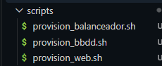

3. Editamos el Vagrantfile con las **4 máquinas** y las **2 subredes**. Para ello, borraremos el contenido del **Vagrantfile** y pegaremos el siguiente código:

> **Nota**: El nombre de usuario es elegible (en mi caso es **`AmparoBalanceador`**, **`AmparoWeb1`**...) 

```ruby
Vagrant.configure("2") do |config|
  # Imagen base para las 4 máquinas: Debian 12 (Bookworm)
  config.vm.box = "debian/bookworm64"

  # =========================================================
  # CAPA 1 (Red Pública): Balanceador de Carga con Apache
  # =========================================================
  config.vm.define "UsuarioBalanceador" do |balanceador|
    balanceador.vm.hostname = "UsuarioBalanceador"
    
    # Subred 1 (conecta Capa 1 con Capa 2)
    balanceador.vm.network "private_network", ip: "192.168.56.10"
    
    # Reenvío de puertos para acceder desde el navegador del PC anfitrión (HTTP y HTTPS)
    balanceador.vm.network "forwarded_port", guest: 80, host: 8080
    balanceador.vm.network "forwarded_port", guest: 443, host: 8443
    
    # Script de aprovisionamiento del Balanceador
    balanceador.vm.provision "shell", path: "scripts/provision_balanceador.sh"
  end

  # =========================================================
  # CAPA 2 (Red Privada): Servidor Web 1 (Backend Web)
  # =========================================================
  config.vm.define "UsuarioWeb1" do |web1|
    web1.vm.hostname = "UsuarioWeb1"
    
    # Subred 1 (para recibir tráfico del Balanceador)
    web1.vm.network "private_network", ip: "192.168.56.11"
    # Subred 2 (para conectarse con la Base de Datos)
    web1.vm.network "private_network", ip: "192.168.57.11"
    
    # Script de aprovisionamiento Web
    web1.vm.provision "shell", path: "scripts/provision_web.sh"
  end

  # =========================================================
  # CAPA 2 (Red Privada): Servidor Web 2 (Backend Web)
  # =========================================================
  config.vm.define "UsuarioWeb2" do |web2|
    web2.vm.hostname = "UsuarioWeb2"
    
    # Subred 1 (para recibir tráfico del Balanceador)
    web2.vm.network "private_network", ip: "192.168.56.12"
    # Subred 2 (para conectarse con la Base de Datos)
    web2.vm.network "private_network", ip: "192.168.57.12"
    
    # Script de aprovisionamiento Web
    web2.vm.provision "shell", path: "scripts/provision_web.sh"
  end

  # =========================================================
  # CAPA 3 (Red Privada): Servidor de Base de Datos (BBDD)
  # =========================================================
  config.vm.define "UsuarioBBDD" do |bbdd|
    bbdd.vm.hostname = "UsuarioBBDD"
    
    # Subred 2 (aislada de la Capa 1, solo conecta con Web1 y Web2)
    bbdd.vm.network "private_network", ip: "192.168.57.20"
    
    # Script de aprovisionamiento de Base de Datos
    bbdd.vm.provision "shell", path: "scripts/provision_bbdd.sh"
  end
end
```

> **EXPLICACIÓN DEL CÓDIGO**
> ---
> En el código anterior, podemos destacar ciertos bloques del código, como pueden ser:
>
> - **`config.vm.define` (4 bloques)**: Definen las 4 máquinas con el nombre de usuario que hayamos puesto:
>
> - **Separación en dos subredes privadas (`56.x` y `57.x`)**:
>
>   - **Subred 1 (`192.168.56.0/24`)**: Une al **balanceador** (**`.10`**) con los **dos servidores web** (**`.11` y `.12`**)
>
>   - **Subred 2 (`192.168.57.0/24`)**: Une los **dos servidores web (`.11` y `.12`)** con la **Base de Datos (`.20`)**. De esta manera, la **Base de Datos** queda en otra subred y el **Balanceador** nunca puede tocarla directamente.
>
> - **`forwarded_port` (reenvío de puertos)**: Solo la máquina de la **Capa 1** expone los puertos **`80`** (**`8080`** del anfitrión) y **`443`** (**`8443`** del anfitrión) para recibir el tráfico **HTTP** y **HTTPS** desde fuera.

La siguiente imagen muestra mi **Vagrantfile**:

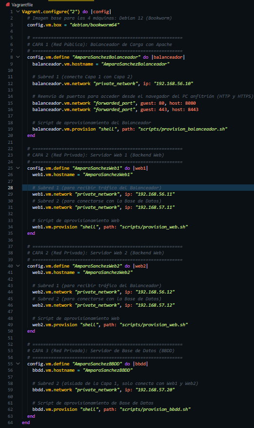

Y con esto ya tendríamos la preparación del entorno.

A continuación, pasaremos a configurar el aprovisionamiento de cada capa.

> **NOTA EXTRA**
> ---
> **¿Por qué es más óptimo empezar a configurar las capas de la más alta a la menos (Capa 3 > Capa 2 > Capa 1)?**
>
>Se debe a una dependencia técnica, donde destacamos los dos puntos siguientes:
>
>   -  Para la configuración de las **Webs (Capa 2)**, es necesario que la **Base de Datos (Capa 3)** ya exista y esté lista para recibir conexiones.
>
>   - Para configurar el **Balanceador (Capa 1)**, necesitaremos los **servidores Web (Capa 2)** existiendo y con una página lista para que el balanceador envíe el tráfico.
>
> Ya sabiendo esto, pasamos a la configuración de estas.

## **_2. Aprovisionamiento de la Capa 3 (Base de Datos)_**

Pasamos a configurar la **Capa 3 (Base de Datos)**, donde instalaremos el servidor **MySQL/MariaDB** y configurándolo en el nivel más profundo y aislado de la red.

> En resumen, el objetivo principal es **aislar** la máquina de **Internet** y configurarla para que solamente acepte conexiones y consultas desde las IP exactas de ambos servidores web (**Capa 2**).

Para ello, disponemos del archivo **`provision_bbdd.sh`** (que lo creamos anteriormente en la carpeta **scripts**) donde pegaremos el siguiente código:

```bash
#!/bin/bash
set -x

# 1. Instalar MariaDB, Git y UFW
apt-get update
apt-get install -y mariadb-server git ufw

# 2. Permitir conexiones externas en MariaDB
sed -i "s/127.0.0.1/0.0.0.0/g" /etc/mysql/mariadb.conf.d/50-server.cnf
systemctl restart mariadb

# 3. Clonar repositorio e importar base de datos
rm -rf /tmp/iaw-practica-lamp
git clone https://github.com/josejuansanchez/iaw-practica-lamp.git /tmp/iaw-practica-lamp
mysql -u root < /tmp/iaw-practica-lamp/db/database.sql

# 4. Crear usuario con acceso exclusivo para Web1 y Web2
mysql -u root -e "DROP USER IF EXISTS 'lamp_user'@'192.168.57.11';"
mysql -u root -e "CREATE USER 'lamp_user'@'192.168.57.11' IDENTIFIED BY 'password';"
mysql -u root -e "GRANT ALL PRIVILEGES ON lamp_db.* TO 'lamp_user'@'192.168.57.11';"

mysql -u root -e "DROP USER IF EXISTS 'lamp_user'@'192.168.57.12';"
mysql -u root -e "CREATE USER 'lamp_user'@'192.168.57.12' IDENTIFIED BY 'password';"
mysql -u root -e "GRANT ALL PRIVILEGES ON lamp_db.* TO 'lamp_user'@'192.168.57.12';"
mysql -u root -e "FLUSH PRIVILEGES;"

# 5. Configurar cortafuegos (Solo puerto 3306 para las webs)
ufw default deny incoming
ufw default allow outgoing
ufw allow 22/tcp
ufw allow from 192.168.57.11 to any port 3306 proto tcp
ufw allow from 192.168.57.12 to any port 3306 proto tcp
ufw --force enable

# 6. Aislar la máquina de Internet
ip route del default
```

> **EXPLICACIÓN DEL CÓDIGO**
> ---
> En relación al código anterior, analizaremos su configuración:
>
> - **`bind-address` (0.0.0.0)**: Cambiamos a **`0.0.0.0`** para que la **Base de Datos** pueda recibir peticiones desde la red privada, pues por defecto, esta solo se escucha a sí misma (**`127.0.0.1`**)
>
> - **Permisos restrictivos**: En vez de crear un usuario abierto, definimos dos accesos exactos (**`192.168.57.11` para Web1** y **`192.168.57.12` para Web2**).
>
> - **`ufw` (cortafuegos)**: Cerramos todas las conexiones de entrada y abrimos solamente el puerto **`3306` (MySQL)** exclusivamente para las IPs de la **Capa 2**.
>
> - **`ip route del default` (aislamiento de red)**: Eliminamos la puerta de enlace por defecto, de manera que dejamos al servidor desconectado de **Internet**, cumpliendo así con las políticas de las **NACLs** (o **Listas de Control de Acceso**)

En la siguiente captura se muestra el contenido de mi **`provision_bbdd.sh`**:

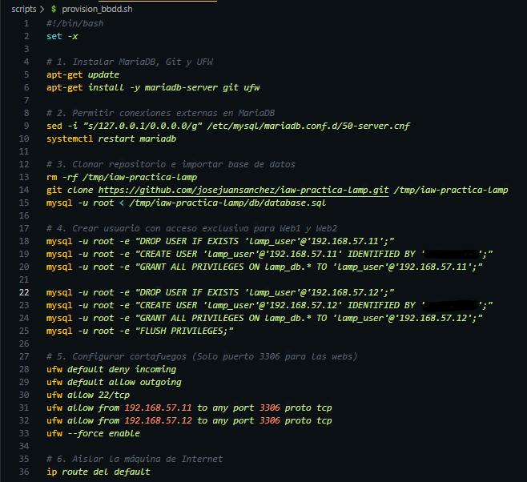

Y con esto, ya hemos terminado de configurar la **Capa 3 (Base de Datos)**.

---

## **_3. Aprovisionamiento de la Capa 2 (Servidores Web)_**

En cuanto al aprovisionamiento de los **servidores Web (Capa 2)**, tenemos como objetivo:

1. Instalar **Apache** y **PHP**

2. Descargar la **aplicación web** de la práctica ([enlace](https://github.com/josejuansanchez/iaw-practica-lamp))

3. Conectar la **aplicación** con la IP privada de nuestra **Base de Datos (`192.168.57.20`)**

4. Proteger ambos servidores con el **cortafuegos (`ufw`)** para que solamente acepten las visitas que vengan del **Balanceador** de la **Capa 1 (`192.168.56.10`)**.

> **Nota**: Para ambos **servidores Web** usaremos el mismo script (**`provision_web.sh`**) y añadiremos de manera automática el nombre de la máquina (**`hostname`**) en la portada de la web para distinguir qué servidor nos atiende en cada recarga.

El código que debemos insertar en **`provision_web.sh`** (de la carpeta **scripts**) es el siguiente:

```bash
#!/bin/bash
set -x

# 1. Instalar Apache, PHP, conector MySQL, Git y UFW
apt-get update
apt-get install -y apache2 php libapache2-mod-php php-mysql git ufw

# 2. Clonar la aplicación web y moverla al directorio raíz de Apache
rm -rf /tmp/iaw-practica-lamp
git clone https://github.com/josejuansanchez/iaw-practica-lamp.git /tmp/iaw-practica-lamp
rm -rf /var/www/html/*
cp -r /tmp/iaw-practica-lamp/src/* /var/www/html/

# 3. Configurar config.php para conectar con la Base de Datos de la Capa 3 (192.168.57.20)
sed -i "s/localhost/192.168.57.20/g" /var/www/html/config.php
sed -i "s/database_name_here/lamp_db/g" /var/www/html/config.php
sed -i "s/username_here/lamp_user/g" /var/www/html/config.php
sed -i "s/password_here/password/g" /var/www/html/config.php

# 4. Identificar el servidor web en la portada para comprobar el balanceo de carga
sed -i "s/Simple LAMP web app/Simple LAMP web app - Atendido por: $(hostname)/g" /var/www/html/index.php

# 5. Ajustar permisos y reiniciar Apache
chown -R www-data:www-data /var/www/html
systemctl restart apache2

# 6. Configurar cortafuegos (Solo permite tráfico HTTP desde el Balanceador)
ufw default deny incoming
ufw default allow outgoing
ufw allow 22/tcp
ufw allow from 192.168.56.10 to any port 80 proto tcp
ufw --force enable

# 7. Aislar la máquina de Internet (Simulando Subred Privada)
ip route del default
```

> **EXPLICACIÓN DEL CÓDIGO**
> ---
> - **`/var/www/html` (despliegue de la web)**: Clonamos el repositorio de la práctica, borramos el **`index.html`** por defecto de **Apache** y copiamos el código fuente de la **aplicación (`src/*`)** a **`/var/www/html`**.
>
> - **`config.php` (conexión con la capa 3)**: Con el uso de **`sed`** sustituimos **`localhost`** por la **IP privada** de nuestro servidor de **Base de Datos (`192.168.57.20`)** y ponemos la contraseña definida en el script (recordatorio de establecer la contraseña personalizada).
>
> - **`hostname` (id de la máquina)**: Modificamos el título en **`index.php`** para mostrar el nombre de la máquina (**UsuarioWeb1** o **UsuarioWeb2**, aunque en mi caso es **AmparoSanchezWeb1** y **AmparoSanchezWeb2**)
>
> - **`ufw` + `ip route del default` (seguridad)**: Bloqueamos las entradas y abrimos el puerto **`80` (HTTP)** única y exclusivamente para la **IP del Balanceador (`192.168.56.10`)**. Por último, cortamos la salida a **Internet** con **`ip route del default`**

La siguiente captura muestra el ejemplo de mi script **`provision_web.sh`**:

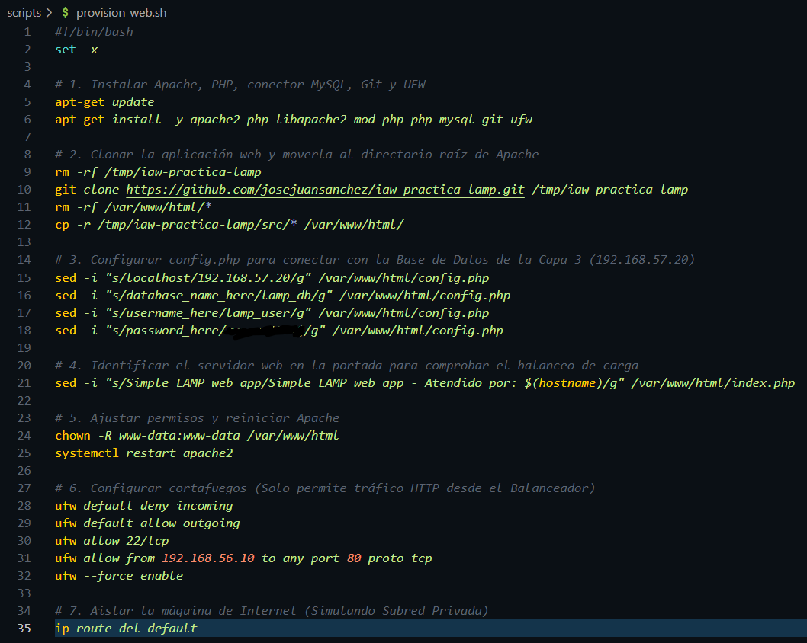

Y con esto, ya hemos terminado de configurar la **Capa 2 (Servidores Web)**.

---

## **_4. Aprovisionamiento de la Capa 1 (Balanceador de Carga)_**

Haremos como última configuración el aprovisionamiento de la **Capa 1 (`Balanceador de Carga`)**, cuyos objetivos son:

1. Instalar **Apache** y activar los módulos de **[proxy inverso](https://www.cloudflare.com/es-es/learning/cdn/glossary/reverse-proxy/)** y **balanceo de carga ([Round Robin](https://www.cloudflare.com/es-es/learning/dns/glossary/round-robin-dns/))**

> **Conceptos**
> ---
> - **Proxy inverso**: **servidor o aplicación** situada entre los **usuarios (clientes)** y los **servidores web de backend**. _Intercepta las solicitudes de los usuarios para reenviarlas al servidor adecuado y devolver la respuesta al cliente_, simulando que habla con el servidor origen.
>
> - **Round Robin**: **Algoritmo** usado para _distribuir el tráfico de red o las solicitudes de los clientes entre un grupo de servidores_ de forma rotativa y secuencial.

2. Configurar el **host virtual** para que reparta las peticiones entre las **IPs privadas** de **Web 1 (`192.168.56.11`) y Web 2 (`192.168.56.12`)**.

3. Habilitar el acceso seguro por **HTTPS** (dejando preparado **[Let's Encrypt](https://letsencrypt.org/)** / **[Certbot](https://certbot.eff.org/)** para entornos de dominio público en **[No-IP](https://www.noip.com/es-MX)** y generando un **certificado SSL** con **[OpenSSL](https://www.openssl.org/)** para validar el candado **HTTPS** en nuestro entorno local de **[Vagrant](https://developer.hashicorp.com/vagrant)**)

4. Configurar el **cortafuegos (`ufw`)** abriendo los puertos **`22` (SSH), `80` (HTTP) y `443` (HTTPS)**.

Para ello, debemos insertar el siguiente código:

> **Recordatorio**: Cambiar usuario por el nombre insertado (en mi caso **amparosanchez.ddns.net**)

```bash
#!/bin/bash
set -x

# 1. Instalar Apache, OpenSSL, Certbot y UFW
apt-get update
apt-get install -y apache2 openssl certbot python3-certbot-apache ufw

# 2. Activar módulos de Proxy Inverso, Balanceador (Round Robin) y SSL
a2enmod proxy
a2enmod proxy_http
a2enmod proxy_balancer
a2enmod lbmethod_byrequests
a2enmod ssl
a2enmod headers
a2enmod rewrite

# 3. Generar certificado SSL autofirmado para pruebas HTTPS en entorno local
mkdir -p /etc/apache2/ssl
openssl req -x509 -nodes -days 365 -newkey rsa:2048 \
  -keyout /etc/apache2/ssl/balanceador.key \
  -out /etc/apache2/ssl/balanceador.crt \
  -subj "/C=ES/ST=Badajoz/L=Merida/O=IESAlbarregas/OU=ASIR/CN=usuario.ddns.net"

# 4. Crear el archivo de configuración del Balanceador (HTTP y HTTPS)
cat <<EOF > /etc/apache2/sites-available/load-balancer.conf
<VirtualHost *:80>
    ServerName usuario.ddns.net

    <Proxy balancer://mycluster>
        # Servidor Web 1
        BalancerMember http://192.168.56.11
        # Servidor Web 2
        BalancerMember http://192.168.56.12
    </Proxy>

    ProxyPass / balancer://mycluster/
    ProxyPassReverse / balancer://mycluster/
</VirtualHost>

<VirtualHost *:443>
    ServerName usuario.ddns.net

    SSLEngine on
    SSLCertificateFile /etc/apache2/ssl/balanceador.crt
    SSLCertificateKeyFile /etc/apache2/ssl/balanceador.key

    <Proxy balancer://mycluster>
        # Servidor Web 1
        BalancerMember http://192.168.56.11
        # Servidor Web 2
        BalancerMember http://192.168.56.12
    </Proxy>

    ProxyPass / balancer://mycluster/
    ProxyPassReverse / balancer://mycluster/
</VirtualHost>
EOF

# 5. Habilitar el balanceador y desactivar el sitio por defecto
a2ensite load-balancer.conf
a2dissite 000-default.conf
systemctl restart apache2

# (Opcional en red pública / AWS) Solicitud de certificado con Certbot y Let's Encrypt:
# certbot --apache -m correo@dominio.es --agree-tos --no-eff-email -d amparosanchez.ddns.net --non-interactive

# 6. Configurar cortafuegos (Puertos públicos 22, 80 y 443)
ufw default deny incoming
ufw default allow outgoing
ufw allow 22/tcp
ufw allow 80/tcp
ufw allow 443/tcp
ufw --force enable
```

> **EXPLICACIÓN DEL CÓDIGO**
> ---
> - **`a2enmod` (módulos de Apache)**: Activamos **`proxy`** y **`proxy_http`** (**Apache** actúa como intermediario), **`proxy_balancer`** y **`lbmethod_byrequests`** (reparte las visitas equitativamente una a cada servidor = **Round Robin**) y **`ssl`** (cifra el tráfico **HTTPS**)
>
> - **`load-balancer.conf` (clúster de balanceo)**: Dentro de **`<Proxy balancer://mycluster>`** definimos con **`BalancerMember`** las IPs privadas de nuestros dos servidores de la **Capa 2 (`192.168.56.11` y `192.168.56.12`)** y con **`ProxyPass`** enviamos todo el tráfico entrante hacia ese grupo.
>
> - **`OpenSSL` y `Certbot` (certificado SSL)**: Cuando trabajamos en máquinas virtuales locales donde **Let's Encrypt** no puede entrar desde Internet para verificar un dominio **No-IP**, generamos un certificado con **`openssl`** para que el puerto **`443`** funcione en local, dejando documentado el comando de **`certbot`** que pide para despliegues con **IP pública**.
>
> - **`ufw` (seguridad)**: En esta capa abrimos al exterior los puertos **`80` (HTTP)** y **`443` (HTTPS)** además del **`22` (SSH)**, y no eliminamos la **puerta de enlace por defecto** (la máquina pertenece a la subred pública).

La siguiente captura muestra la configuración de mi **`provision_balanceador.sh`**:

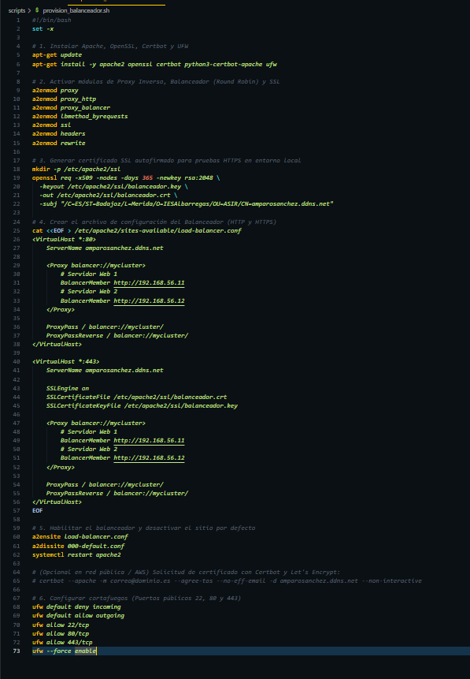

Y con esto, ya hemos terminado de configurar la **Capa 1 (Balanceador de Carga)**.

---

## **_5. Comprobación del funcionamiento_**

Por último, haremos ciertas comprobaciones para ver que el funcionamiento está correcto.

Para ello, levantaremos las 4 máquinas con los siguientes comandos:

> **Recordatorio**: Cambiar "Usuario" por el nombre insertado (en mi caso **`vagrant up AmparoSanchezBBDD`**, por ejemplo).

```bash
vagrant up UsuarioBBDD
vagrant up UsuarioWeb1
vagrant up UsuarioWeb2
vagrant up UsuarioBalanceador
```

Accederemos a las máquinas con:

```bash
vagrant ssh UsuarioBBDD
vagrant ssh UsuarioWeb1
vagrant ssh UsuarioWeb2
vagrant ssh UsuarioBalanceador
```

Y haremos las comprobaciones por punto.

### **Comprobación 1: Estado de las máquinas**

Ejecutaremos `vagrant status` y mostraremos el estado (**running**) de las máquinas:

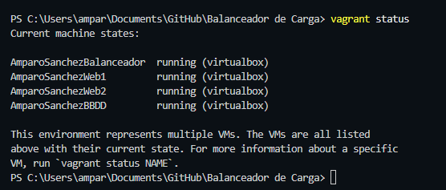

### **Comprobación 2: Servicios activos y cortafuegos**

Ejecutaremos los siguientes comandos en cada capa para ver el **servicio activo** y de **firewall (`ufw status`)**

> **Recordatorio**: Cambiar **"Usuario"** por el insertado (**AmparoSanchezBBDD** en mi caso)

- **Capa 3**

`vagrant ssh UsuarioBBDD -c "sudo systemctl status mariadb --no-pager && sudo ufw status"`

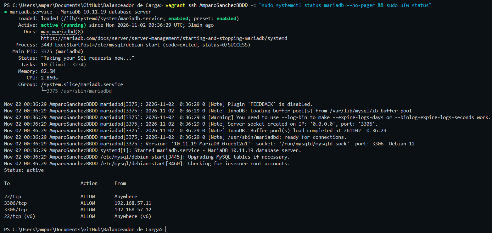

- **Capa 2**

**Web 1**

`vagrant ssh UsuarioWeb1 -c "sudo systemctl status apache2 --no-pager && sudo ufw status"`

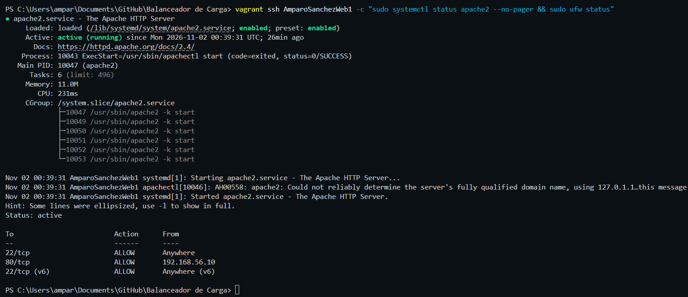


**Web 2**

`vagrant ssh UsuarioWeb2 -c "sudo systemctl status apache2 --no-pager && sudo ufw status"`

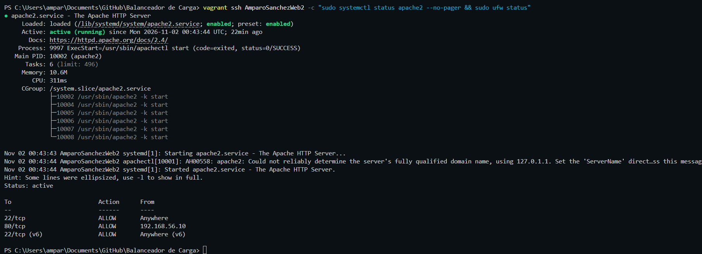

- **Capa 1**

`vagrant ssh UsuarioBalanceador -c "sudo systemctl status apache2 --no-pager && sudo ufw status"`

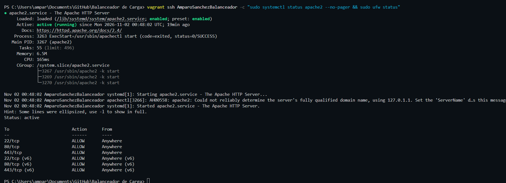

### **Comprobación 3: Acceso HTTPS y Certificado SSL**

Abriremos el navegador y entramos en **`https://localhost:8443`**

> **Nota**: Al ser un certificado autofirmado con **OpenSSL** en entorno local, aceptamos la advertencia del navegador.

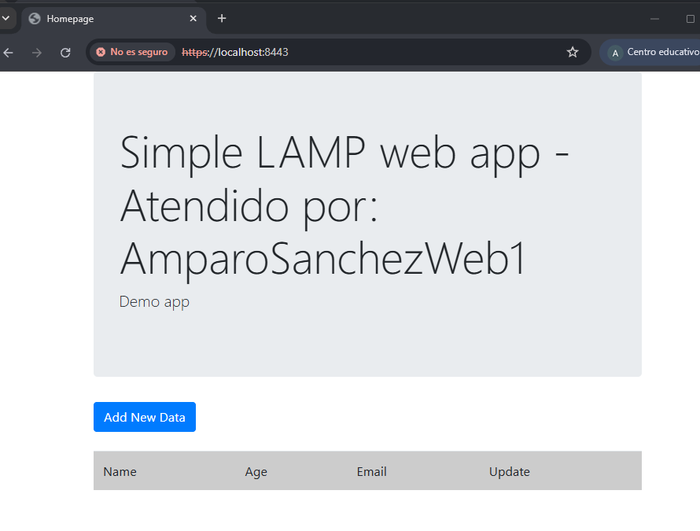

### **Comprobación 4: Balanceo de carga (Round Robin) y Persistencia en la Base de Datos**

Entramos a **`https://localhost:8443`**, hacemos clic en **Add New Data** para añadir un registro nuevo y recargamos la página un par de veces. Con esto comprobamos dos cosas a la vez:

- El balanceador reparte las visitas alternando entre **Web1** y **Web2**

- Ambos servidores web leen y escriben en la misma base de datos de la **Capa 3**:

De manera que:

- Atiende **Web1** (mostrando el registro guardado en la **Base de Datos**):

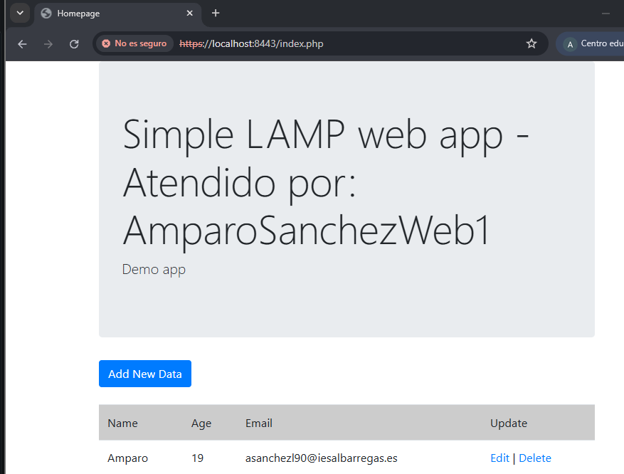

- Atiende **Web2** (mostrando exactamente el mismo registro al recargar):

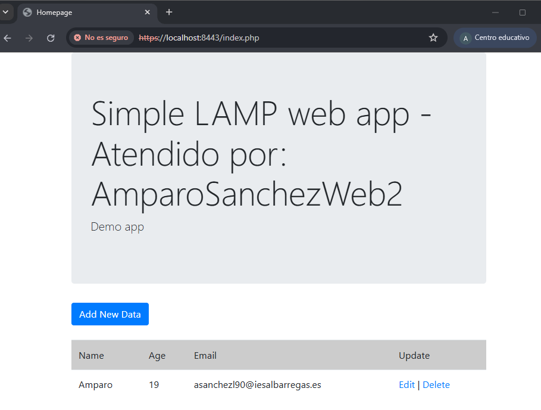

Y estas serían todas las comprobaciones a realizar.

---

## **_Screencast_**

A continuación, un video acerca de una prueba del funcionamiento de la infraestructura: **[Enlace](screencast/Balanceador%20de%20carga.mp4)**

---

## **_Incidencias_**

#### **_Incidencia 1_**

Durante la comprobación 3 (acceso **HTTPS** y **certificado SSL**) intentando acceder al balanceador, ha saltado error de que no encuentra la página:

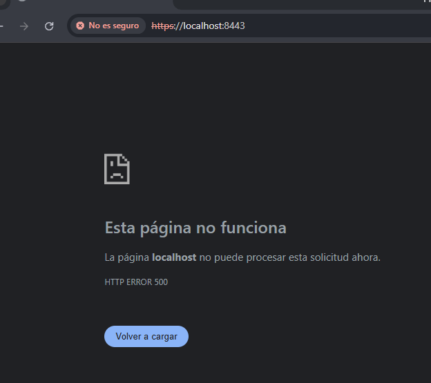

- **Causa**: Al revisar el registro de errores de Apache (**`/var/log/apache2/error.log`**) en el servidor web, comprobamos que fallaba la conexión con la **Capa 3 (Base de Datos)**. Esto se debe a dos cosas:

  1. En el archivo **`/var/www/html/config.php`** no se habían sustituido los marcadores por defecto (`database_name_here`, `username_here` y `password_here`)

  2. En el servidor **MariaDB** no se había terminado de crear la base de datos **`lamp_db`** (`Unknown database 'lamp_db'`).

- **Solución**: El error se ha solucionado entrando a la **Base de Datos** por **SSH** y ejecutando directamente la creación de **`lamp_db`**, la tabla de **`users`** y los permisos para ambas máquinas web:

```bash
sudo mysql -u root <<EOF
-- 1. Crear y seleccionar la base de datos
CREATE DATABASE IF NOT EXISTS lamp_db;
USE lamp_db;

-- 2. Crear la tabla de usuarios
CREATE TABLE IF NOT EXISTS users (
    id int(11) NOT NULL auto_increment,
    name varchar(100) NOT NULL,
    age int(3) NOT NULL,
    email varchar(100) NOT NULL,
    PRIMARY KEY (id)
);

-- 3. Asignar permisos a los servidores Web1 y Web2
GRANT ALL PRIVILEGES ON lamp_db.* TO 'lamp_user'@'192.168.57.11';
GRANT ALL PRIVILEGES ON lamp_db.* TO 'lamp_user'@'192.168.57.12';
FLUSH PRIVILEGES;
EOF
```

---

## **_Fuentes consultadas_**

- **Apuntes de clase**

- [**Repositorio de la aplicación web de ejemplo**](https://github.com/josejuansanchez/iaw-practica-lamp)

- [**Documentación oficial de Apache HTTP Server**](https://httpd.apache.org/docs/2.4/mod/mod_proxy_balancer.html)

- [**Documentación oficial de Vagrant (HashiCorp)**](https://developer.hashicorp.com/vagrant/docs/multi-machine)

- **Conceptos de red y distribución de tráfico (Cloudflare)**: 
  - [**Proxy Inverso**](https://www.cloudflare.com/es-es/learning/cdn/glossary/reverse-proxy/)
  - [**Round Robin**](https://www.cloudflare.com/es-es/learning/dns/glossary/round-robin-dns/)

- **Certificados SSL/TLS**:
  - [**Certbot**](https://certbot.eff.org/)
  
  - [**OpenSSL**](https://www.openssl.org/)